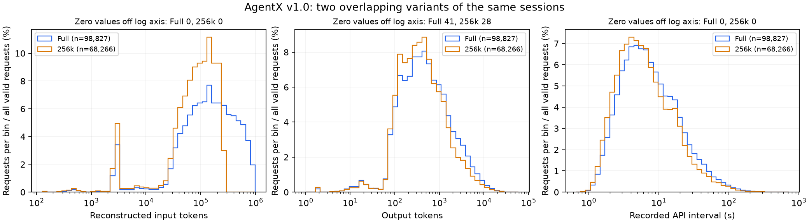

# AgentX v1.0 Full：宏观分析及与256k版本对照

生成：2026-10-22T15:46:01.281845+00:00；验收：PASS。离线只读全部本地JSONL，不执行轨迹、Agent、工具或模型。

## 来源和覆盖

- Full：`semianalysisai/cc-traces-weka-062126`，固定revision `23f152f6f0f9399a85901b89a6458def0ef16729`，Apache-2.0（数据卡声明）。
- 256k：沿用旧分析manifest绑定的revision `8fecd2fc56694469f758f0afbbb6335ad3043740`；本轮重新扫描实际原始记录。
- Full不是原始业务日志全集：仍是经过版本、请求数、并发、图像、分类器和去重等规则筛选的公开请求流；Full保留更长上下文。

| 指标 | Full | 256k |
|---|---:|---:|
| 会话 | 393 | 393 |
| 主Agent请求 | 56,798 | 28,444 |
| Subagent内部请求 | 42,029 | 39,822 |
| 全部模型请求 | 98,827 | 68,266 |
| Subagent group | 1,697 | 1,697 |
| 含Subagent的会话 | 175 | 175 |
| 重建输入总量 | 21,635,381,376 | 6,891,228,864 |
| 输出token总量 | 106,474,498 | 58,728,807 |

## 实际字段分布

分位数按(n−1)×p线性插值；每个字段有自己的有效n。不同variant不能合并分母。

| 字段 | Full有效n / median / p95 | 256k有效n / median / p95 |
|---|---|---|
| in | 98,827 / 142016.0 / 682880.0 | 68,266 / 88768.0 / 228224.0 |
| out | 98,827 / 444.0 / 4298.0 | 68,266 / 376.0 / 3262.75 |
| api_time | 98,827 / 6.652 / 40.78389999999998 | 68,266 / 5.683 / 33.627250000000004 |
| ttft | 56,432 / 2.636 / 9.703899999999994 | 28,173 / 2.191 / 7.467999999999989 |
| think_time | 98,434 / 2.2840000000001055 / 161.3722000000108 | 67,875 / 1.171999999999997 / 71.18219999999963 |

`in`来自hash块数×64，既不是精确分词器计数，也不是实际计费输入；总量与分布均保留该限制。`api_time`、`ttft`和`think_time`仅按来源保存字段统计，不能解释为远端纯推理、真实业务工具或用户思考耗时。

## 两版本关系与cap影响

- Full较256k多30,561个请求；按Full请求数分母，差值为30.924%。两者共有393个会话ID；各自独有ID见comparison.json。
- 按会话+原生agent路径+除t以外全部请求payload的SHA-256匹配（保留重复次数）：匹配68,266；Full独有30,561；256k独有0。不按位置或仅token长度强配。
- 唯一payload匹配中，393个会话满足统一时间偏移，其中2个存在非零偏移；歧义请求不配时间。
- Full中input+output>256,000的请求为30,561；按该cap的保留总数与256k相等：True。边界恰为256,000的Full请求为0。
- cap作用于请求；部分Subagent内部请求可能被移除，保留group数量相同不代表内部请求完整。Full本身另有约990k重建输入上限，不是无过滤原始代理全集。

## Subagent与前缀结构

Full含Subagent的会话175/393；group状态仅按保存标签统计：`{"completed": 1697}`，不转换为任务成功率。
保存group duration_ms的median=136141.0；group total_tokens仅单独分布，不与叶子请求token总量相加。
同一会话/agent stream内相邻hash前缀比较：Full 96,737对、256k 66,176对；共享block数的median分别为2185.0和1332.0。cap移除中间请求后相邻关系改变，不将两者差异解释为缓存命中率或性能收益。

## 业务工具与资源分析边界

发布方methodology明确公开语料不含原始prompt、代码、工具参数或工具返回。实际请求/group字段出现次数和非空次数见summary.json；不能从工具调用间隔或group状态补推业务操作、成功率与工具独占成本。
本地Full的group.tool_use_count非空0/1697；即使有聚合数，也不提供具体工具身份/参数/结果。
没有本地CPU、内存、I/O、网络或任务结果测量。不能从Full恢复这些字段，也不进行性能、模型能力或费用排名。

## 核验与产物

输入哈希已核验；Full/256k分别7/7个来源stats字段逐项重算，详情见summary.json。解析/结构问题Full=0，256k=0。
逐会话/agent scope分别统计时间区间，绝不把不同会话的相对时钟拼成统一时间线；跨scope并集、工具耗时与等待/思考时间不推断。旧分析报告与代码不改写。

- [逐trace明细](per_trace.jsonl) · [逐会话对照](per_trace_comparison.csv) · [机器摘要](summary.json) · [匹配详情](comparison.json) · [manifest](manifest.json)
- [分布图SVG](full-vs-256k.svg) · [PNG](full-vs-256k.png)

来源：[Full固定版本](https://huggingface.co/datasets/semianalysisai/cc-traces-weka-062126/tree/23f152f6f0f9399a85901b89a6458def0ef16729)；[官方methodology](https://inferencex.semianalysis.com/agentx/methodology)。
