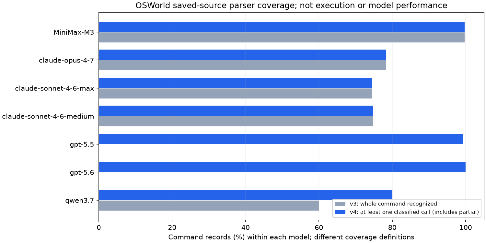

# OSWorld v4：命令静态解析覆盖与保存序列复核

生成：2026-10-22T16:10:59.006131+00:00。本地同一固定语料，755条model×task记录、7个来源模型标签、108个任务定义/本地任务键。未执行任何轨迹、GUI动作、模型或benchmark；v1/v2/v3原件保留。

## 覆盖变化

v3整段只接受白名单直接调用，import、赋值或任一未知语句会拒绝整段。v4支持已知import/别名和字面量声明，按顶层语句分别识别；未知语句保留边界。新增hotkey/typewrite/write、time.sleep、screenshot和clipboard等明确函数名。

| 来源模型标签 | command记录 | v3识别源码调用 | v4识别源码调用 | v4整段已知 / 部分 / 未知 / 仅元数据 |
|---|---:|---:|---:|---|
| MiniMax-M3 | 35,282 | 3,241,101 | 3,241,101 | 35,169 / 0 / 113 / 0 |
| claude-opus-4-7 | 34,278 | 39,053 | 39,057 | 26,857 / 0 / 7,421 / 0 |
| claude-sonnet-4-6-max | 27,249 | 27,184 | 27,186 | 20,323 / 0 / 6,926 / 0 |
| claude-sonnet-4-6-medium | 31,192 | 31,706 | 31,708 | 23,302 / 0 / 7,890 / 0 |
| gpt-5.5 | 16,282 | 0 | 114,995 | 16,053 / 126 / 103 / 0 |
| gpt-5.6 | 34,884 | 0 | 101,247 | 34,716 / 167 / 1 / 0 |
| qwen3.7 | 21,883 | 13,128 | 237,411 | 17,516 / 0 / 4,367 / 0 |

源码调用数是保存代码中的顶层调用出现次数，不是实际执行次数。一个command可有多个调用，不能用调用数除以记录数当覆盖率。v4的“部分”保留已识别调用及未知边界，绝不把整段称完整。

## 行为构成与保存序列

逐model/task的分类计数、函数名、转换与连续段见per_trajectory.jsonl；每个command的状态、分类、源码SHA及原始行号见command_records.jsonl。None边界不产生跨未知片段转换，循环/分支/函数体不展开。重复记录不按step_num、call_id或相同代码擅自去重。

本轮同时增加Qwen对typewrite/hotkey的识别。MiniMax极大量press保留为重复源码出现，不能解释为用户真实按键量。Claude文本输入包装中的try/赋值仍是未知结构；其原生type记录在v3原生层已存在，不能据静态未知声称没有输入动作。

## 原生动作与batch协议

原生层v3的native_action_category_counts/native_sequence逐项保留，未将GPT的computer_call包装转换成原生动作。新的命令分类提供另一层源码证据；两层不相加。screenshot与其command中的sleep占位分别保留，不把占位时间当真实截图耗时。

保存call_id按同一model/task聚合，检查batch_size、index范围、重复index、last标记和完整性；结果在summary.json的saved_protocol字段。ID组不等于实际HTTP请求或真实执行批次，更不证明并行；同ID重复或冲突保留为歧义。

## 核验与边界

v3全部输入/输出及分析代码逐项验哈希；inventory覆盖6177个原始/缓存文件。每条轨迹的保存记录数和command数与v3一致；未新增或筛除任务。
任务定义、评分/终止字段、MiniMax usage沿用已冻结v3证据；版本绑定、前台应用、动作实际效果、耗时与资源仍未知。源码中不含某函数或被标为unknown均不证明该动作没有执行。

[机器摘要](summary.json) · [覆盖表](coverage.csv) · [逐轨迹](per_trajectory.jsonl) · [逐command审计](command_records.jsonl) · [manifest](manifest.json)

[SVG](command-coverage.svg) · [PNG](command-coverage.png)
图中v3为整段识别、v4为至少有一条已识别调用，分母均为该模型command记录；完整/部分须结合上表，图不表示模型能力。
