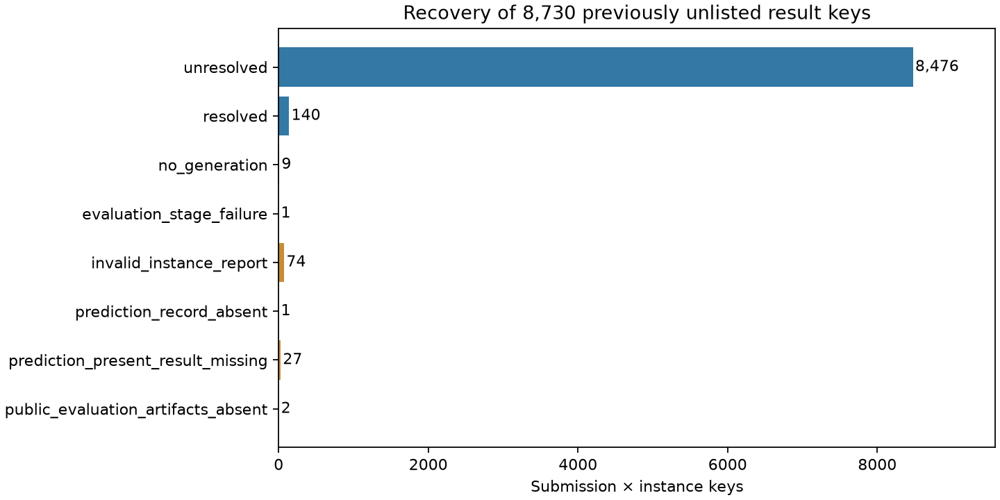

# SWE-bench：逐任务评价补全与复核

本轮补齐公开逐任务报告、旧评测日志与预测文件，并更新行为×结果分层。旧数据与旧报告保留；不执行Agent、保存命令、patch、benchmark或verifier。

## 实际新增的数据

- 18,306份逐任务report.json、1,716份旧评测日志、36份预测文件、39份缺报告任务的评测诊断日志。
- 主批次20,097文件、510,938,578字节；另补1份39字节测试输出，共20,098文件、510,938,617字节（约510.9 MB）。HTTP、listing/HEAD字节数、ETag及本地SHA256核验完成；上游空文件按原字节保存。
- 41组对应logs命名空间全部分页列举结束；下载了其中全部逐任务报告和4个旧格式组的完整评测日志，而非只查看成功清单。

## 原来8,730个未列入汇总清单的键，现在是什么状态

| 本轮状态 | 数量 |
|---|---:|
| 已公布预测清单不含此任务 | 1 |
| 逐任务报告：未解决 | 8,476 |
| 已有预测、公开评测结果缺失 | 27 |
| 对应公开目录无评价产物 | 2 |
| 上游空报告 | 74 |
| 生成后的评测阶段异常 | 1 |
| 已解决 | 140 |
| 来源明确标记未生成 | 9 |

8,625个已取得明确解决状态或来源未生成标签，另1个从配套测试输出确认1800秒超时；74个报告及对应测试输出在上游均为零字节，另30个没有对应逐任务报告。后30个的预测清单/目录情况在下表及逐任务缺口CSV展开，不自动转为任务失败。



## 原来缺汇总评价文件的两组

| 组 | 已解决 | 未解决 | 对应公开结果仍缺失 |
|---|---:|---:|---:|
| 20250615_agentless_mindlink | 0 | 0 | 366 |
| lite/20251009_MAYA_claude-sonnet-4-5-20250929 | 155 | 67 | 78 |

MAYA实际有222份逐任务报告，155个resolved=true、67个false；另外78个未公布同名逐任务报告，其中76个目录只有patch.diff。Mindlink的同名logs目录完整列举为0对象，对应预测文件HEAD为404；现有366条轨迹中没有可替代外部评测的明确结果证据。这里的缺失限定于已登记同名公开来源，不声称世界上不存在其他私有或异名版本。

## 全范围结果与剩余来源问题

| 状态（分母：19,514个submission×原生任务键） | 数量 |
|---|---:|
| 旧日志已完成、公开评价未解决 | 1,147 |
| 已解决 | 8,661 |
| 生成后的评测阶段异常 | 103 |
| 来源明确标记未生成 | 400 |
| 已公布预测清单不含此任务 | 1 |
| 逐任务报告：未解决 | 8,543 |
| 汇总与逐任务报告冲突 | 5 |
| 来源明确标记缺日志 | 26 |
| 已有预测、公开评测结果缺失 | 105 |
| 对应公开目录无评价产物 | 368 |
| 预测patch为空 | 81 |
| 上游空报告 | 74 |

这些状态把原生报告布尔值、旧日志和流程阶段分开。no_generation、空patch、缺日志及评测异常不冒充经过完整测试后的普通失败。旧日志的“未解决”只在保存日志明确完成且公开清单同时含applied/with_logs、但不含resolved时推断；并非对任意缺失ID取补集。30条原生Patch Apply Failed标记及Bracket的sympy-20428明确超时另归评测异常。

[逐组完整统计](reviewed_group_outcomes.csv) · [每个剩余问题及目录证据](remaining_source_gaps.csv) · [5个冲突任务](conflicting_results.csv)

5个任务的Git汇总resolved=true、当前S3逐任务报告resolved=false：MASAI的3个astropy任务、learn-by-interact的django-13807、Warp的requests-5414。两份证据分别保存，冲突实例不归入统一成功/失败分层。固定Git索引与当前可变S3产物可能属于不同修订，不能据此断言具体原因。

## 任务身份和行为分析更正

KGCompass的300个文件名附有模型后缀；旧宽松文件名规则把它误当作Instance ID的一部分，造成关联缺失并虚增去重任务数。本轮逐个读取原文Task Metadata中的Instance ID并核对文件名前缀。跨组去重任务数更正为2,294，上一轮2,594包含这300个错误身份。来源文件、保存行为数量和原90条选择不变。

报告格式支持17,237份以Instance ID为键的嵌套JSON和994份按精确S3任务目录绑定的平铺JSON；75份零字节报告保持原样，其中1份配套测试输出明确超时，74份配套输出也为空。不能因平铺JSON没有内部ID而误判为下载失败，也不将目录绑定说成同一次attempt的完整证明。

原90条样本现为：{'unresolved': 41, 'resolved': 28, 'legacy_completed_not_resolved': 20, 'no_generation': 1}。[关联明细](reviewed_subset90_links.jsonl)。全范围按组、保存单位、结果重算中位数/IQR，共103个分层，见[行为与结果CSV](reviewed_behavior_strata.csv)。不同格式和任务集不用于模型排名或因果推断。

原生patch与公开预测的字节比较：289条Moatless记录完全一致，其余2,805条所选三格式记录缺少可比较的原生patch或公开预测证据。对没有精确patch证据的记录，仅声称同发布组/任务关系。没有本轮CPU、内存、I/O或可靠工具时长的新证据。

## 复现与验证

```bash
python3 -B -m unittest tests.test_swebench_instance_results tests.test_swebench_instance_result_review -v
python3 -B scripts/swebench_instance_results.py --analyze
python3 -B scripts/swebench_instance_result_review.py
```

分析和报告入口均拒绝覆盖已有输出；复现需保留完整本地原始资产，在独立副本中新建输出目录。源文件及获取记录见[下载manifest](../../../data/catalog/public_trace_acquisition/SWEBENCH-INSTANCE-RESULTS-20261023/manifest.json)。[初始分析manifest](manifest.json)、[复核manifest](review-manifest.json)分别冻结各阶段，最新机器汇总为[reviewed_summary.json](reviewed_summary.json)。
