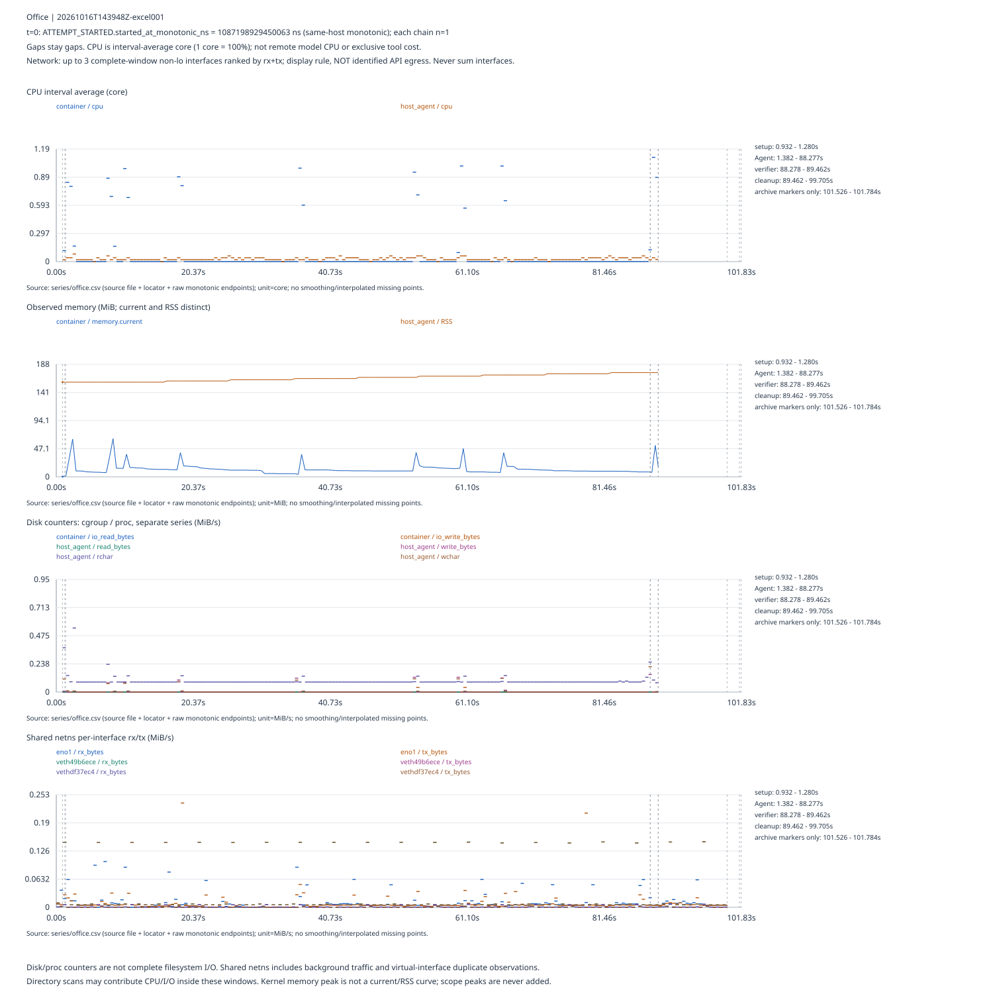
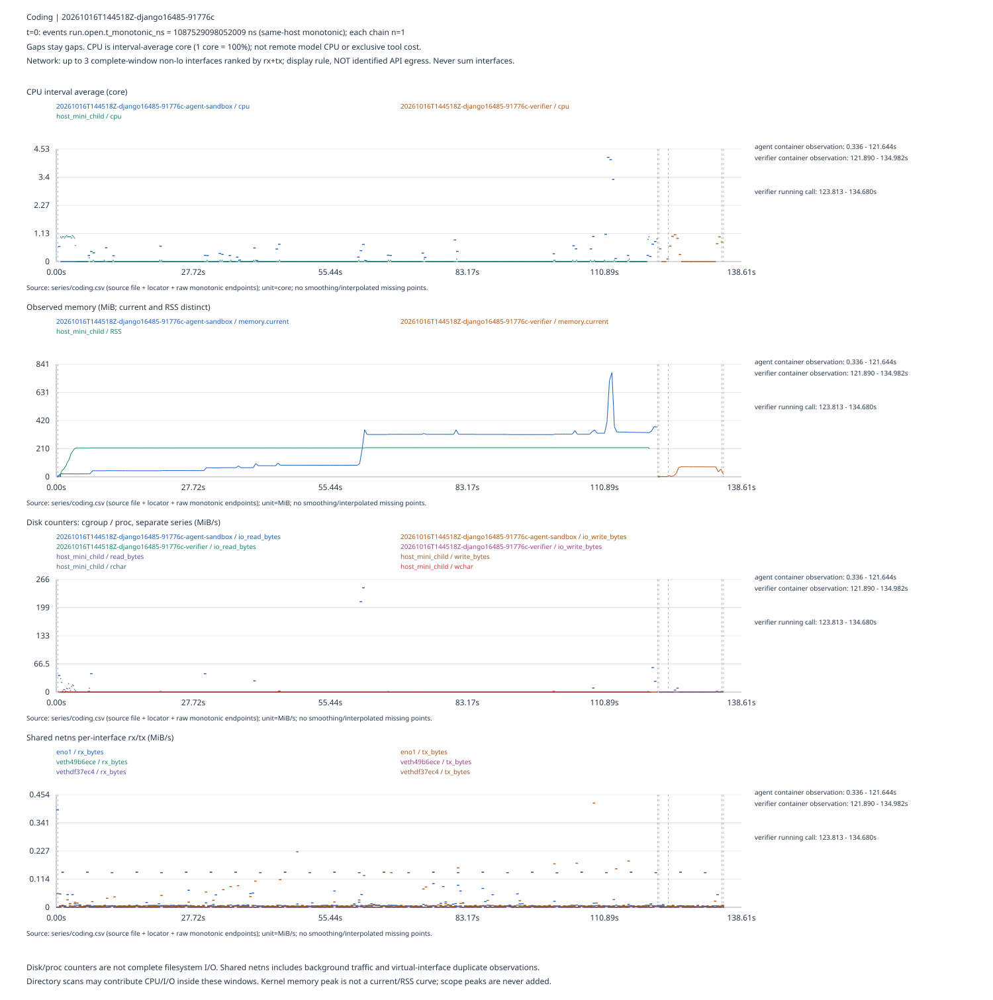
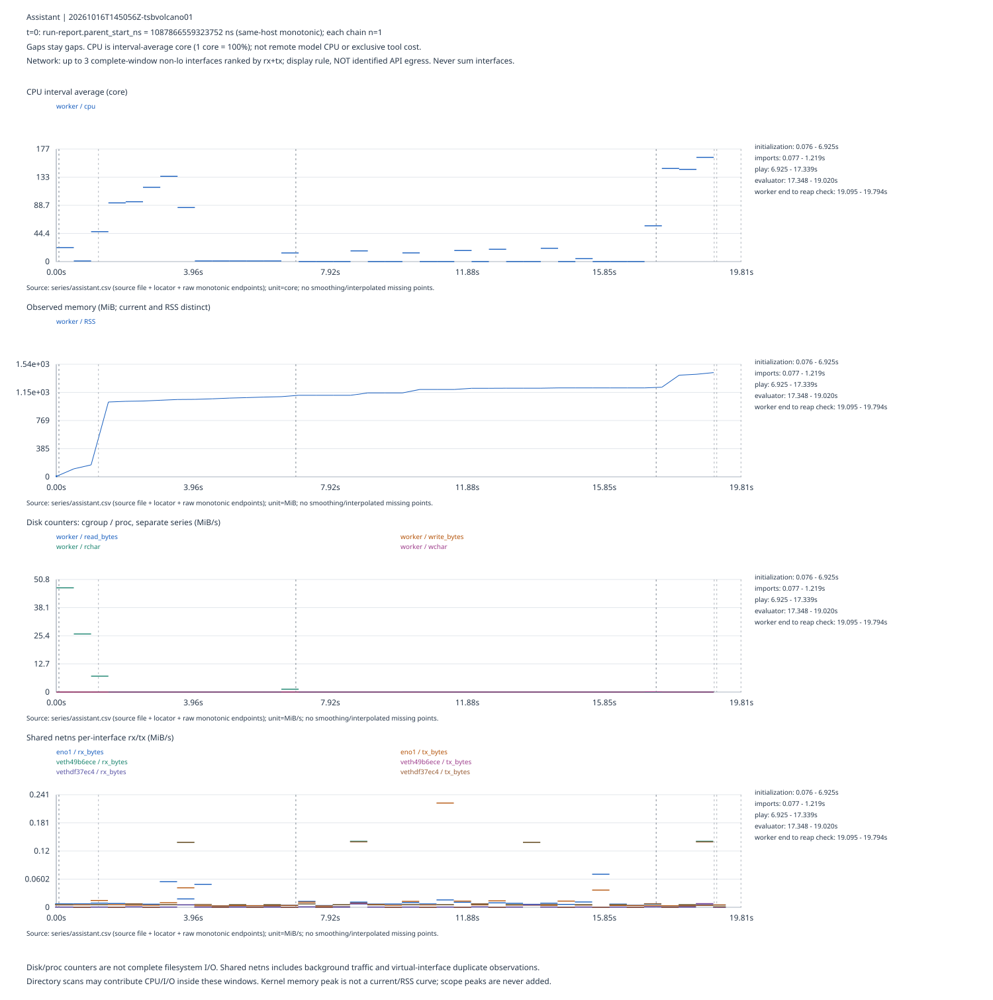

# 火山网关三链单次行为—资源分析

三次独立验证的主要计数、资源曲线与目录边界可核验；不是类别对照实验，每类n=1，不合并旧27次重复。

|链路|请求/角色|工具/角色|任务结果|终止|attempt wall s|清理/归档|
|---|---|---|---|---|---|---|
|Office|8 / {'agent': 8}|{'bootstrap': 2, 'agent': 7}|1.0|finish|101.830000|归档哈希/文件集通过；RC=0|
|Coding|20 / {'agent': 20}|{'agent': 30}|True|Submitted|138.611690|归档哈希/文件集通过；RC=7|
|Assistant|7 / {'agent': 6, 'user': 1}|{'agent': 5, 'user': 1}|0.9484251274276947|{'conversation_active': False, 'user_end_conversation_executed': True, 'reason': 'user_end_conversation'}|19.807992|归档哈希/文件集通过；RC=0|

## 有限观察（均为本次固定任务n=1）

- Office：setup窗口 0.349s / 共享CPU 0.023599s；Agent窗口 86.896s / 共享CPU 6.744537s；verifier窗口 1.184s / 共享CPU 0.971523s。阶段/边界口径独立，不解释为工具独占或因果。
- Coding：agent container observation窗口 121.308s / 共享CPU 14.268578s；verifier container observation窗口 13.092s / 共享CPU 3.560612s。阶段/边界口径独立，不解释为工具独占或因果。
- Assistant：initialization窗口 6.850s / 共享CPU 301.990000s；play窗口 10.414s / 共享CPU 58.560000s；evaluator窗口 1.672s / 共享CPU 248.890000s。阶段/边界口径独立，不解释为工具独占或因果。
- 任务目录前后扫描与共享netns逐接口观测均有可回读证据；Assistant场景状态在内存，目录not_applicable。日志/输出目录、缓存与任务目录分列，缓存仍unsupported。
- CPU区间峰与阶段只作共现：逐scope的峰值区间、源位置和相交阶段在JSON中；不能证明是某个工具、线程池或函数造成。

## Office：20261016T143948Z-excel001

[独立SVG](figures/office.svg) · [作图CSV](series/office.csv)。t=0来自 `ATTEMPT_STARTED.started_at_monotonic_ns`，原始值 `1087198929450063` ns。
实际响应model分别为 `{'deepseek-v4-flash-ga-260731': 5, 'deepseek-v4-flash-0731': 3}`。两种标识不能据名称判为两个不同后端或保证同一后端。

|scope|保存点数（含边界）|采样窗 s|有效CPU区间/候选|有效差分CPU-s|内存采样峰 bytes|内核peak bytes|实际间隔median/max s|
|---|---|---|---|---|---|---|---|
|container|179|88.532562685|178/178|7.773932|memory.current: 66785280|78888960|0.500484126/0.500838621|
|host_agent|179|88.532562685|178/178|2.45|RSS: 182784000|None|0.500484126/0.500838621|

|scope|I/O计数器|有效区间/候选|有效观测差分 bytes|gap原因|
|---|---|---|---|---|
|container|io_read_bytes|178/178|0.0|{}|
|container|io_write_bytes|178/178|40960.0|{}|
|host_agent|read_bytes|178/178|0.0|{}|
|host_agent|write_bytes|178/178|491520.0|{}|
|host_agent|rchar|178/178|8679443.0|{}|
|host_agent|wchar|178/178|565816.0|{}|

|实际阶段/观测跨度|wall s|共享scope CPU-s|说明|
|---|---|---|---|
|setup|0.348660486|0.023599|counter read timestamps differ slightly from lifecycle event; shared container; archive markers are not full archive cost|
|Agent|86.89561036|6.744537|counter read timestamps differ slightly from lifecycle event; shared container; archive markers are not full archive cost|
|verifier|1.184234459|0.971523|counter read timestamps differ slightly from lifecycle event; shared container; archive markers are not full archive cost|
|cleanup|10.242189045|None|counter read timestamps differ slightly from lifecycle event; shared container; archive markers are not full archive cost|
|archive markers only|0.258038011|None|counter read timestamps differ slightly from lifecycle event; shared container; archive markers are not full archive cost|

工具顺序（不映射成工具独占资源）：

get_task_metadata → inspect_document → copy_file → inspect_document → xlsx_read_sheet → xlsx_read_sheet → xlsx_set_formula → xlsx_set_formula → xlsx_read_sheet

角色计数：{'bootstrap': 2, 'agent': 7}；普通工具错误 0，控制流终态 0；终止后请求 0。
网络保存 201 点、339 接口；展示 ['eno1', 'veth49b6ece', 'vethdf37ec4']。按全窗口有效同接口rx+tx排序只为展示，不是API出口识别，跨接口不求和。完整逐接口统计在per_run.jsonl。

|展示接口|完整有效窗rx变化 B|完整有效窗tx变化 B|rx/tx有效区间|
|---|---|---|---|
|eno1|1166469|951677|200/200|
|veth49b6ece|1797934|107955|200/200|
|vethdf37ec4|105845|1795284|200/200|

|目录角色/scope|路径|before B|after B|增长 B|状态|扫描wall ns（前/后）|
|---|---|---|---|---|---|---|
|task_workspace_submission / agent_container:/root/submission|/root/submission|0|6629|6629|observed|59221/78291|
|host log/output/cache / host_visible_trial_and_archive|/home/lcq/agent_workload_characterization/data/raw/generated/DOCOPS-MEASUREMENT-VOLCANO-02/20261016T143948Z-excel001|300|443160|442860|observed|52031/273674|
|host log/output/cache / host_and_container|None|None|None|None|unavailable_or_partial|1960/3970|

已保存资源读取wall成本：83816151 ns；独立宿主monitor读取：None ns；共享网络读取：2523623230 ns。None表示未保存；读取wall成本不是完整采集器CPU。
观测覆盖状态：`{'semantic_pairing': 'verified', 'resource_gaps': {'container': {}, 'host_agent': {}}, 'coverage': 'only the saved scope windows; not the whole attempt', 'supplement_aggregate': 'partial', 'cache_and_api_bytes': 'unsupported/unknown'}`。无任何已列资源scope覆盖的attempt区间（monotonic ns）为 `[[1087198929450063, 1087199858712633], [1087288391275318, 1087300759450063]]`；这不是“等待/思考时间”。
目录扫描位于相应资源观测窗口内时，CPU/I/O包括这一观测活动；没有剔除成“纯任务成本”。宿主日志结束占用测量早于最终归档完成，不是最终归档总大小。
null/None表示未知或不可用，不是0。RSS/current/内核peak分列，不相加。网络与资源采样窗口均不等于attempt完整生命周期。

## Coding：20261016T144518Z-django16485-91776c

[独立SVG](figures/coding.svg) · [作图CSV](series/coding.csv)。t=0来自 `events run.open.t_monotonic_ns`，原始值 `1087529098052009` ns。
实际响应model分别为 `{'deepseek-v4-flash-0731': 4, 'deepseek-v4-flash-ga-260731': 16}`。两种标识不能据名称判为两个不同后端或保证同一后端。

|scope|保存点数（含边界）|采样窗 s|有效CPU区间/候选|有效差分CPU-s|内存采样峰 bytes|内核peak bytes|实际间隔median/max s|
|---|---|---|---|---|---|---|---|
|20261016T144518Z-django16485-91776c-agent-sandbox|245|121.308454583|244/244|14.268578|memory.current: 816259072|1042989056|0.5003304865/0.500686329|
|20261016T144518Z-django16485-91776c-verifier|29|13.091624098|28/28|3.560612|memory.current: 79110144|79851520|0.500356268/0.503906437|
|host_mini_child|597|119.429541873|595/596|3.8400000000000003|RSS: 228921344|None|0.20037138850000002/0.200872026|

|scope|I/O计数器|有效区间/候选|有效观测差分 bytes|gap原因|
|---|---|---|---|---|
|20261016T144518Z-django16485-91776c-agent-sandbox|io_read_bytes|244/244|374398976.0|{}|
|20261016T144518Z-django16485-91776c-agent-sandbox|io_write_bytes|244/244|49152.0|{}|
|20261016T144518Z-django16485-91776c-verifier|io_read_bytes|28/28|7303168.0|{}|
|20261016T144518Z-django16485-91776c-verifier|io_write_bytes|28/28|1699840.0|{}|
|host_mini_child|read_bytes|595/596|0.0|{'scope_identity_missing': 1}|
|host_mini_child|write_bytes|595/596|307200.0|{'scope_identity_missing': 1}|
|host_mini_child|rchar|595/596|38712028.0|{'scope_identity_missing': 1}|
|host_mini_child|wchar|595/596|1383297.0|{'scope_identity_missing': 1}|

|实际阶段/观测跨度|wall s|共享scope CPU-s|说明|
|---|---|---|---|
|agent container observation|121.308454583|14.268578|resource boundary window, not exact Agent function duration|
|verifier container observation|13.091624098|3.560612|resource boundary window, not exact Agent function duration|
|setup|None|None|no precise standalone saved setup interval|
|cleanup|None|None|container stop/removal markers are points, not start/end spans|
|verifier running call|10.867433436|None||

工具顺序（不映射成工具独占资源）：

bash → bash → bash → bash → bash → bash → bash → bash → bash → bash → bash → bash → bash → bash → bash → bash → bash → bash → bash → bash → bash → bash → bash → bash → bash → bash → bash → bash → bash → bash [Submitted控制流]

角色计数：{'agent': 30}；普通工具错误 0，控制流终态 1；终止后请求 0。
网络保存 272 点、339 接口；展示 ['eno1', 'veth49b6ece', 'vethdf37ec4']。按全窗口有效同接口rx+tx排序只为展示，不是API出口识别，跨接口不求和。完整逐接口统计在per_run.jsonl。

|展示接口|完整有效窗rx变化 B|完整有效窗tx变化 B|rx/tx有效区间|
|---|---|---|---|
|eno1|1586256|2121591|271/271|
|veth49b6ece|2417667|130423|271/271|
|vethdf37ec4|127665|2414108|271/271|

|目录角色/scope|路径|before B|after B|增长 B|状态|扫描wall ns（前/后）|
|---|---|---|---|---|---|---|
|agent_workspace / agent_container:/testbed|/testbed|332749843|337624112|4874269|observed|131313627/67581721|
|verifier_workspace / verifier_container:/testbed|/testbed|332749843|337364093|4614250|observed|102970707/70140225|
|host log/output/cache / host_visible_runner_output|/home/lcq/agent_workload_characterization/data/raw/generated/CODING-MEASUREMENT-VOLCANO-01/20261016T144518Z-django16485-91776c|424|650880|650456|observed|58250/172002|
|host log/output/cache / host|None|None|None|None|unavailable_or_partial|2270/3791|

已保存资源读取wall成本：75514674 ns；独立宿主monitor读取：88981857 ns；共享网络读取：3851032061 ns。None表示未保存；读取wall成本不是完整采集器CPU。
观测覆盖状态：`{'semantic_pairing': 'verified', 'resource_gaps': {'20261016T144518Z-django16485-91776c-agent-sandbox': {}, '20261016T144518Z-django16485-91776c-verifier': {}, 'host_mini_child': {'cpu': 1, 'read_bytes': 1, 'write_bytes': 1, 'rchar': 1, 'wchar': 1}}, 'coverage': 'only the saved scope windows; not the whole attempt', 'supplement_aggregate': 'partial', 'cache_and_api_bytes': 'unsupported/unknown'}`。无任何已列资源scope覆盖的attempt区间（monotonic ns）为 `[[1087529098052009, 1087529434029189], [1087650742483772, 1087650988262695], [1087664079886793, 1087667709742086]]`；这不是“等待/思考时间”。
目录扫描位于相应资源观测窗口内时，CPU/I/O包括这一观测活动；没有剔除成“纯任务成本”。宿主日志结束占用测量早于最终归档完成，不是最终归档总大小。
null/None表示未知或不可用，不是0。RSS/current/内核peak分列，不相加。网络与资源采样窗口均不等于attempt完整生命周期。

RC7保持原值：入口要求archive_status==complete，而共享runner成功值为ok；本次execution/evaluation/archive/cleanup均ok，归档文件集和哈希通过，是入口退出码误判，不是已证实归档损坏；未修改入口、旧返回码或重跑。
保存命令的静态用途分类：{'file_locate': 1, 'mixed': 19, 'file_view': 4, 'script_execute': 6}，分母为保存工具调用，不是CPU或时长比例。shell普通返回码分布：{'0': 29}，非零返回不与Submitted控制流终态混淆。
容器目标采样0.5s；host_mini_child实际约0.2s，未保存独立目标间隔，target保持unknown。末次宿主读取process_exited造成一个有效性gap，未补成0，也不据此把容器有效区间丢弃。

## Assistant：20261016T145056Z-tsbvolcano01

[独立SVG](figures/assistant.svg) · [作图CSV](series/assistant.csv)。t=0来自 `run-report.parent_start_ns`，原始值 `1087866559323752` ns。
实际响应model分别为 `{'deepseek-v4-flash-0731': 2, 'deepseek-v4-flash-ga-260731': 5}`。两种标识不能据名称判为两个不同后端或保证同一后端。

|scope|保存点数（含边界）|采样窗 s|有效CPU区间/候选|有效差分CPU-s|内存采样峰 bytes|内核peak bytes|实际间隔median/max s|
|---|---|---|---|---|---|---|---|
|worker|39|19.000092961|38/38|609.08|RSS: 1494155264|None|0.49999768899999997/0.500086394|

|scope|I/O计数器|有效区间/候选|有效观测差分 bytes|gap原因|
|---|---|---|---|---|
|worker|read_bytes|38/38|0.0|{}|
|worker|write_bytes|38/38|118784.0|{}|
|worker|rchar|38/38|42906340.0|{}|
|worker|wchar|38/38|114365.0|{}|

|实际阶段/观测跨度|wall s|共享scope CPU-s|说明|
|---|---|---|---|
|initialization|6.849826154|301.99|imports is nested within initialization; do not sum both; shared worker counters|
|imports|1.142056294|11.69|imports is nested within initialization; do not sum both; shared worker counters|
|play|10.413814511|58.56|imports is nested within initialization; do not sum both; shared worker counters|
|evaluator|1.6721066|248.89|imports is nested within initialization; do not sum both; shared worker counters|
|worker end to reap check|0.699305088|None|observed tail span, not an exclusive full cleanup cost|

工具顺序（不映射成工具独占资源）：

search_contacts → send_message_with_phone_number [已记录错误] → get_cellular_service_status → set_cellular_service_status → send_message_with_phone_number → end_conversation

角色计数：{'agent': 5, 'user': 1}；普通工具错误 1，控制流终态 0；终止后请求 0。
网络保存 40 点、339 接口；展示 ['eno1', 'veth49b6ece', 'vethdf37ec4']。按全窗口有效同接口rx+tx排序只为展示，不是API出口识别，跨接口不求和。完整逐接口统计在per_run.jsonl。

|展示接口|完整有效窗rx变化 B|完整有效窗tx变化 B|rx/tx有效区间|
|---|---|---|---|
|eno1|225738|267214|39/39|
|veth49b6ece|354014|19692|39/39|
|vethdf37ec4|18880|352698|39/39|

|目录角色/scope|路径|before B|after B|增长 B|状态|扫描wall ns（前/后）|
|---|---|---|---|---|---|---|
|任务状态|内存场景|N/A|N/A|N/A|not_applicable|N/A|
|host log/output/cache / host_visible_worker_output|/home/lcq/agent_workload_characterization/data/raw/generated/TOOLSANDBOX-MEASUREMENT-VOLCANO-01/20261016T145056Z-tsbvolcano01|329|130837|130508|observed|82441/284904|
|host log/output/cache / host|None|None|None|None|unavailable_or_partial|2440/3970|

已保存资源读取wall成本：None ns；独立宿主monitor读取：None ns；共享网络读取：474831763 ns。None表示未保存；读取wall成本不是完整采集器CPU。
观测覆盖状态：`{'semantic_pairing': 'verified', 'resource_gaps': {'worker': {}}, 'coverage': 'only the saved scope windows; not the whole attempt', 'supplement_aggregate': 'partial', 'cache_and_api_bytes': 'unsupported/unknown'}`。无任何已列资源scope覆盖的attempt区间（monotonic ns）为 `[[1087866559323752, 1087866566349009], [1087885566441970, 1087886367315866]]`；这不是“等待/思考时间”。
目录扫描位于相应资源观测窗口内时，CPU/I/O包括这一观测活动；没有剔除成“纯任务成本”。宿主日志结束占用测量早于最终归档完成，不是最终归档总大小。
null/None表示未知或不可用，不是0。RSS/current/内核peak分列，不相加。网络与资源采样窗口均不等于attempt完整生命周期。

ConnectionError是保存的业务工具返回（并非自动归为网关/infra失败）；结束由User end_conversation。官方similarity保留原值，不自设成功阈值。初始化、play、evaluator的CPU窗口各自独立，不能把整个worker CPU统称Agent工具成本。

## 核验与边界

三份raw文件集及哈希、外层归档和完整保存身份关联通过。当前源码漂移记录：[]。只核验实际读取的输入，不声称重审全仓库。
每类只有一次固定任务，不能推断类别规律、稳定性、因果、效率或排名；不与旧批混算。请求时长不是思考时间，wall−CPU没有等待时间含义。无HTTP传输hook和账单，实际HTTP数/费用unknown；token与项目尝试不代替它们。
采样细目（逐指标valid/gap/reason、读取状态、时间异常、窗口）保存在summary.json/per_run.jsonl；未插值、未补零。CSV仅保存图中资源scope与最多3个选中接口的实际点/区间，其余接口保留机器可读统计。
资源峰值与阶段/请求/工具只能称同窗共现，不是独占资源或因果；短调用可能处于同一0.5s采样区间。不同CPU端点窗口不强行守恒。
本轮仅离线分析；未运行任务或evaluator、未调用API/Docker、未更新HTML、未提交Git。CPU-02/Replay暂停，Gate裁定不变。
